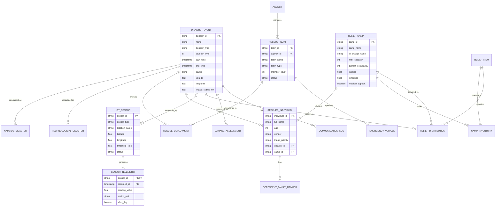

# Smart Disaster Response Coordination System (NDMA)
## Comprehensive Database Architecture, EER Modeling, 3NF Normalization & Advanced Database Implementation Report

**Course / Subject**: Database Management Systems (DBMS) - Advanced Mini-Project  
**Allocated Problem Statement**: #7 — Design and Development of an Entity Relationship (ER) and Enhanced Entity Relationship (EER) Model for a Smart Disaster Response Coordination System  
**Selected Advanced Database Technology**: **DuckDB** (Embedded Columnar Vectorized OLAP / Analytical Database Engine)

---

## 1. Executive Summary & Problem Context

The **National Disaster Management Authority (NDMA)** is mandated with orchestrating real-time emergency preparedness, immediate rescue operations, resource allocation, and long-term rehabilitation across natural disasters (floods, earthquakes, cyclones, wildfires, landslides) and human-induced catastrophes (industrial chemical spills, structural collapses).

In high-consequence crisis scenarios, traditional row-oriented relational databases struggle with high-frequency IoT telemetry ingestion, real-time spatial proximity joins (matching victims/camps/rescue teams), and large-scale emergency analytics under potential network partitioning. To fulfill NDMA's rigorous operational requirements, this project implements:
1. A rigorous **Conceptual & Logical Database Design** conforming to 3NF / BCNF normalization.
2. An **Enhanced Entity-Relationship (EER)** model capturing complex domain hierarchies, weak entities, aggregations, and categorical union types.
3. An **Advanced Analytical Database Engine (DuckDB)** providing vectorized SQL execution, columnar compression, geospatial distance calculations, and instant analytical querying across disaster logs, resource burn rates, and sensor streams.
4. A **Modern Tactical Emergency Command Web Dashboard** with GIS interactive mapping, live telemetry streams, victim registry, relief camp capacity tracking, and an interactive SQL analytics console.

---

## 2. Requirement Analysis & Specification

### 2.1 Functional Requirements (FR)
- **FR1: Disaster Event Monitoring**: Record each disaster with unique identifier, disaster type (flood, earthquake, etc.), classification (natural vs. technological), severity scale (Cat 1–5 / Richter / Richter Equivalent), GPS coordinates, start/end timestamps, radius of impact, and active status.
- **FR2: Sensor Telemetry & Early Warning Alerts**: Ingest high-frequency readings from weather stations, seismic sensors, river water-level gauges, and smoke detectors. Trigger automatic critical alerts upon threshold violation.
- **FR3: Rescue Operations & Task Dispatch**: Mobilize specialized rescue teams (NDRF, SDRF, Paramilitary, Marine, Medical) and deploy emergency vehicles (ambulances, helicopters, inflatable boats).
- **FR4: Evacuee Registration & Relief Camp Allocation**: Register rescued individuals with triage status, medical needs, and immediate dependencies. Allocate individuals to temporary relief camps based on live capacity and vacancy constraints.
- **FR5: Relief Material Logistics & Distribution**: Manage inventory of food rations, potable water, medical trauma kits, and blankets across staging depots and log outbound consignments to designated camps.
- **FR6: Post-Disaster Damage Assessment**: Log structural loss, economic impact, casualty reports, and infrastructure restoration status for post-disaster planning.
- **FR7: Real-Time Analytical Decision Support**: Compute camp occupancy percentages, regional resource shortages, emergency response latency, and sensor trend aggregations.

### 2.2 Non-Functional Requirements (NFR)
- **Data Integrity & Consistency**: Enforce strict primary, foreign key, domain, and check constraints to prevent orphan dispatch records or camp over-allocation.
- **Low Latency Analytical Execution**: Sub-second query times over hundreds of thousands of telemetry logs and historical dispatch records.
- **Fault-Tolerant & Offline-Ready Architecture**: The database must operate reliably on command vehicles and field servers without requiring external network connectivity or heavy client-server daemons.
- **Extensible Schema**: Ability to incorporate vector embeddings and spatial GIS geometries without requiring major schema overhauls.

---

## 3. Entity, Attribute & Relationship Identification

### 3.1 Entities and Key Attributes

| Entity | Description | Key Attributes (PK denoted with *) | Other Attributes |
| :--- | :--- | :--- | :--- |
| **Disaster_Event** | Base emergency incident | `disaster_id`* | `name`, `disaster_type`, `severity_level` (1-5), `start_time`, `end_time`, `status`, `latitude`, `longitude`, `impact_radius_km`, `estimated_affected_pop` |
| **Natural_Disaster** (Subtype) | Specialization of Disaster | `disaster_id`* (FK) | `meteorological_category`, `wind_speed_kmh`, `flood_depth_m`, `seismic_magnitude` |
| **Technological_Disaster** (Subtype) | Man-made/industrial catastrophe | `disaster_id`* (FK) | `facility_name`, `hazardous_material_type`, `leak_rate`, `containment_status` |
| **IoT_Sensor** | Monitoring station / hardware | `sensor_id`* | `sensor_type`, `model_no`, `installation_date`, `latitude`, `longitude`, `status`, `threshold_limit`, `unit_of_measure` |
| **Sensor_Telemetry** (Weak Entity) | High-frequency time-series data | `(sensor_id*, timestamp*)` | `reading_value`, `battery_level_pct`, `alert_triggered`, `signal_strength_dbm` |
| **Agency** | Coordinating government / NGO body | `agency_id`* | `agency_name`, `agency_type` (NDMA, SDRF, Red Cross, Armed Forces), `contact_phone`, `headquarters` |
| **Rescue_Team** | Deployed response squad | `team_id`* | `agency_id` (FK), `team_name`, `team_type`, `member_count`, `readiness_status`, `base_location` |
| **Emergency_Vehicle** | Transport & rescue asset | `vehicle_id`* | `team_id` (FK), `vehicle_type` (Ambulance, Boat, Chopper, Truck), `registration_no`, `capacity_persons`, `fuel_status_pct` |
| **Relief_Camp** | Shelter facility | `camp_id`* | `camp_name`, `in_charge_name`, `contact_phone`, `latitude`, `longitude`, `max_capacity`, `current_occupancy`, `medical_facility_available` |
| **Rescued_Individual** | Evacuated victim | `individual_id`* | `full_name`, `age`, `gender`, `rescue_timestamp`, `disaster_id` (FK), `camp_id` (FK), `triage_priority` (P1-Immediate, P2-Urgent, P3-Minor, P4-Deceased), `medical_conditions` |
| **Dependent_Family_Member** (Weak Entity)| Victim dependents | `(individual_id*, dependent_seq*)` | `dependent_name`, `relationship`, `age`, `special_needs` |
| **Relief_Item** | Supply catalogue | `item_id`* | `item_name`, `category` (Food, Water, Medicine, Shelter), `unit_of_measure`, `shelf_life_days` |
| **Camp_Inventory** | Stock at relief camp | `(camp_id*, item_id*)` | `quantity_available`, `reorder_threshold`, `last_replenished_at` |
| **Relief_Distribution** | Material shipment log | `distribution_id`* | `disaster_id` (FK), `camp_id` (FK), `item_id` (FK), `quantity_dispatched`, `dispatch_date`, `transport_vehicle_id` (FK), `delivery_status` |
| **Damage_Assessment** | Post-disaster survey report | `assessment_id`* | `disaster_id` (FK), `surveyor_name`, `infrastructure_damage_score` (1-10), `estimated_loss_usd`, `houses_destroyed`, `report_date`, `notes` |
| **Communication_Log** | Inter-agency dispatch logs | `log_id`* | `disaster_id` (FK), `sender_agency_id` (FK), `recipient_agency_id` (FK), `message_text`, `urgency_level`, `log_time` |

### 3.2 Candidate Keys and Foreign Keys
- **Disaster_Event**: PK = `disaster_id`. Candidate Keys: `(name, start_time, latitude, longitude)`.
- **IoT_Sensor**: PK = `sensor_id`. Candidate Keys: `(model_no, latitude, longitude)`.
- **Emergency_Vehicle**: PK = `vehicle_id`. Candidate Key: `registration_no`.
- **Relief_Camp**: PK = `camp_id`. Candidate Key: `(camp_name, latitude, longitude)`.
- **Rescued_Individual**: PK = `individual_id`.

### 3.3 Relationships, Cardinalities & Participation Constraints

1. **Disaster_Event — IoT_Sensor (Monitored_By)**:
   - Cardinality: **M:N** (A disaster affects an area covered by multiple sensors; a sensor network monitors a zone that may experience multiple disasters over time).
   - Participation: Disaster is Total (1..N), Sensor is Partial (0..N).
2. **Disaster_Event — Rescue_Team (Deploys)**:
   - Cardinality: **M:N** (A disaster requires multiple rescue teams; a rescue team can be reassigned to multiple disasters across time).
   - Participation: Disaster has Total participation (at least 1 team dispatched), Team has Partial participation (standby teams exist).
3. **Agency — Rescue_Team (Employs / Manages)**:
   - Cardinality: **1:N** (One agency controls multiple rescue teams; each team belongs to exactly one agency).
   - Participation: Team is Total (must belong to an agency), Agency is Partial (new agency may be setting up teams).
4. **Rescue_Team — Emergency_Vehicle (Operates)**:
   - Cardinality: **1:N** (A rescue team operates multiple vehicles; each vehicle is assigned to at most one team at a given time).
   - Participation: Vehicle is Total, Team is Partial (teams can be on foot/recon).
5. **Disaster_Event — Rescued_Individual (Affects / Rescued_From)**:
   - Cardinality: **1:N** (Each rescued victim is associated with one primary disaster event; one disaster event yields many rescued individuals).
   - Participation: Rescued Individual is Total (must link to a disaster), Disaster is Partial (0 evacuees at early warning phase).
6. **Relief_Camp — Rescued_Individual (Shelters / Accommodates)**:
   - Cardinality: **1:N** (One camp shelters many individuals; an individual is assigned to at most one camp at a time).
   - Participation: Individual is Partial (may be evacuated directly to hospital), Camp is Partial (camp can be empty initially).
7. **Rescued_Individual — Dependent_Family_Member (Has_Dependents)**:
   - Identifying relationship for Weak Entity `Dependent_Family_Member`.
   - Cardinality: **1:N** with Total participation for the weak entity.
8. **Relief_Camp — Relief_Item (Stocks via Camp_Inventory)**:
   - Cardinality: **M:N** resolved into `Camp_Inventory` associative entity.
9. **Disaster_Event — Relief_Distribution (Receives_Relief)**:
   - Cardinality: **1:N** (Relief distributions are organized for specific disaster operations).
10. **Disaster_Event — Damage_Assessment (Evaluated_By)**:
    - Cardinality: **1:N** (Multiple periodic assessments per disaster event). Total participation for assessment.

### 3.4 Special Attribute Types
- **Multivalued Attributes**:
  - `Rescue_Team.specialized_equipment` (e.g., [Sonar, Hydraulic Cutters, Drones])
  - `Relief_Camp.accessible_routes` (e.g., [Air, Water, Highway 7])
- **Derived Attributes**:
  - `Relief_Camp.vacancy` = `max_capacity - current_occupancy`
  - `Disaster_Event.duration_hours` = `DATEDIFF('hour', start_time, COALESCE(end_time, CURRENT_TIMESTAMP))`
  - `Damage_Assessment.total_economic_impact` = `estimated_loss_usd + infrastructure_damage_score * 50000`
- **Composite Attributes**:
  - `Location` = `(latitude, longitude, district, state, pin_code)`
  - `FullName` = `(first_name, last_name)`

---

## 4. Enhanced Entity Relationship (EER) Modeling

The smart disaster coordination ecosystem requires advanced modeling abstractions:

```
                                 [ DISASTER_EVENT ]
                                    (Disjoint 'd')
                                    /            \
                                  /                \
                    [ NATURAL_DISASTER ]    [ TECHNOLOGICAL_DISASTER ]
```

### 4.1 Superclass / Subclass Specialization & Generalization
1. **Disaster Specialization**:
   - **Superclass**: `Disaster_Event` (attributes: `disaster_id`, `name`, `severity_level`, `start_time`, `status`, coordinates).
   - **Disjoint Complete Specialization (`d`, total)**:
     - `Natural_Disaster`: inherits base attributes + (`meteorological_category`, `wind_speed_kmh`, `seismic_magnitude`).
     - `Technological_Disaster`: inherits base attributes + (`facility_name`, `hazardous_material_type`, `containment_status`).
2. **Personnel / Team Specialization**:
   - **Superclass**: `Responder`
   - **Subclasses**: `Rescue_Team`, `Medical_Unit`, `Volunteer_Corps`.

### 4.2 Weak Entity Sets
1. **`Sensor_Telemetry`**:
   - **Owner Entity**: `IoT_Sensor` (Identifying Relationship: `Generates_Telemetry`).
   - **Partial Key**: `timestamp`.
   - **Composite PK**: `(sensor_id, timestamp)`.
   - **Semantics**: A telemetry reading cannot exist without its host sensor hardware.
2. **`Dependent_Family_Member`**:
   - **Owner Entity**: `Rescued_Individual` (Identifying Relationship: `Has_Dependent`).
   - **Partial Key**: `dependent_seq`.
   - **Composite PK**: `(individual_id, dependent_seq)`.

### 4.3 Aggregation
In disaster operations, resources are not allocated simply to an isolated team or an isolated disaster; rather, **resources are allocated to the specific active deployment of a rescue team to a disaster event**.
- We aggregate the relationship `Deployment = (Rescue_Team DEPLOYED_TO Disaster_Event)`.
- This higher-level aggregate entity `Rescue_Deployment` then enters into a relationship with `Resource_Allocation` and `Emergency_Vehicle`.
- **Benefit**: Eliminates ternary redundancy, models the realistic operational lifecycle, and ensures vehicles are linked to a specific mission context.

### 4.4 Category (Union Type)
- **`Relief_Recipient` (Category / Union)**:
  - In relief logistics, supplies can be distributed to either an organized **`Relief_Camp`** OR directly to an isolated **`Affected_Community / Village`**.
  - `Relief_Recipient = Relief_Camp ∪ Affected_Community`
  - Allows `Relief_Distribution` to have a single recipient foreign key referencing the polymorphic category, guaranteeing referential integrity while supporting both institutional and field-level distribution.
- **`Incident_Reporter` (Category / Union)**:
  - An emergency alert or disaster report can originate from an **`IoT_Sensor`**, a **`Weather_Station`**, a **`Registered_Citizen`**, or a **`Government_Official`**.

---

## 5. ER & EER Conceptual Diagram (Mermaid Representation)



---

## 6. Relational Schema Mapping & Referential Integrity

Converting the EER model into relational schemas results in the following target relations:

1. **`agencies`** (
   `agency_id` VARCHAR PRIMARY KEY,
   `agency_name` VARCHAR NOT NULL,
   `agency_type` VARCHAR NOT NULL,
   `contact_phone` VARCHAR,
   `headquarters` VARCHAR
);

2. **`disaster_events`** (
   `disaster_id` VARCHAR PRIMARY KEY,
   `name` VARCHAR NOT NULL,
   `disaster_type` VARCHAR NOT NULL,
   `severity_level` INTEGER CHECK (`severity_level` BETWEEN 1 AND 5),
   `start_time` TIMESTAMP NOT NULL,
   `end_time` TIMESTAMP,
   `status` VARCHAR CHECK (`status` IN ('Active', 'Contained', 'Resolved')),
   `latitude` DOUBLE NOT NULL,
   `longitude` DOUBLE NOT NULL,
   `impact_radius_km` DOUBLE NOT NULL,
   `estimated_affected_pop` INTEGER DEFAULT 0
);

3. **`natural_disasters`** (
   `disaster_id` VARCHAR PRIMARY KEY REFERENCES `disaster_events`(`disaster_id`) ON DELETE CASCADE,
   `meteorological_category` VARCHAR,
   `wind_speed_kmh` DOUBLE,
   `seismic_magnitude` DOUBLE,
   `flood_depth_m` DOUBLE
);

4. **`technological_disasters`** (
   `disaster_id` VARCHAR PRIMARY KEY REFERENCES `disaster_events`(`disaster_id`) ON DELETE CASCADE,
   `facility_name` VARCHAR NOT NULL,
   `hazardous_material_type` VARCHAR,
   `leak_rate` VARCHAR,
   `containment_status` VARCHAR
);

5. **`iot_sensors`** (
   `sensor_id` VARCHAR PRIMARY KEY,
   `sensor_type` VARCHAR NOT NULL,
   `model_no` VARCHAR,
   `location_name` VARCHAR NOT NULL,
   `latitude` DOUBLE NOT NULL,
   `longitude` DOUBLE NOT NULL,
   `threshold_limit` DOUBLE NOT NULL,
   `unit_of_measure` VARCHAR NOT NULL,
   `status` VARCHAR CHECK (`status` IN ('Active', 'Warning', 'Critical', 'Offline'))
);

6. **`sensor_telemetry`** (
   `sensor_id` VARCHAR NOT NULL REFERENCES `iot_sensors`(`sensor_id`) ON DELETE CASCADE,
   `recorded_at` TIMESTAMP NOT NULL,
   `reading_value` DOUBLE NOT NULL,
   `battery_level_pct` DOUBLE,
   `alert_flag` BOOLEAN DEFAULT FALSE,
   PRIMARY KEY (`sensor_id`, `recorded_at`)
);

7. **`rescue_teams`** (
   `team_id` VARCHAR PRIMARY KEY,
   `agency_id` VARCHAR NOT NULL REFERENCES `agencies`(`agency_id`),
   `team_name` VARCHAR NOT NULL,
   `team_type` VARCHAR NOT NULL,
   `member_count` INTEGER NOT NULL CHECK (`member_count` > 0),
   `readiness_status` VARCHAR CHECK (`readiness_status` IN ('Standby', 'Deployed', 'Resting', 'Demobilized')),
   `base_location` VARCHAR
);

8. **`emergency_vehicles`** (
   `vehicle_id` VARCHAR PRIMARY KEY,
   `team_id` VARCHAR REFERENCES `rescue_teams`(`team_id`),
   `vehicle_type` VARCHAR NOT NULL,
   `registration_no` VARCHAR UNIQUE NOT NULL,
   `capacity_persons` INTEGER NOT NULL,
   `fuel_status_pct` DOUBLE
);

9. **`relief_camps`** (
   `camp_id` VARCHAR PRIMARY KEY,
   `camp_name` VARCHAR NOT NULL,
   `in_charge_name` VARCHAR NOT NULL,
   `contact_phone` VARCHAR,
   `latitude` DOUBLE NOT NULL,
   `longitude` DOUBLE NOT NULL,
   `max_capacity` INTEGER NOT NULL CHECK (`max_capacity` > 0),
   `current_occupancy` INTEGER DEFAULT 0 CHECK (`current_occupancy` >= 0),
   `medical_support` BOOLEAN DEFAULT FALSE,
   CONSTRAINT `chk_camp_capacity` CHECK (`current_occupancy` <= `max_capacity`)
);

10. **`rescued_individuals`** (
    `individual_id` VARCHAR PRIMARY KEY,
    `full_name` VARCHAR NOT NULL,
    `age` INTEGER,
    `gender` VARCHAR(10),
    `rescue_timestamp` TIMESTAMP NOT NULL,
    `disaster_id` VARCHAR NOT NULL REFERENCES `disaster_events`(`disaster_id`),
    `camp_id` VARCHAR REFERENCES `relief_camps`(`camp_id`),
    `triage_priority` VARCHAR CHECK (`triage_priority` IN ('P1 - Critical', 'P2 - Urgent', 'P3 - Minor', 'P4 - Deceased')),
    `medical_conditions` VARCHAR
);

11. **`dependent_family_members`** (
    `individual_id` VARCHAR NOT NULL REFERENCES `rescued_individuals`(`individual_id`) ON DELETE CASCADE,
    `dependent_seq` INTEGER NOT NULL,
    `dependent_name` VARCHAR NOT NULL,
    `relationship` VARCHAR NOT NULL,
    `age` INTEGER,
    `special_needs` VARCHAR,
    PRIMARY KEY (`individual_id`, `dependent_seq`)
);

12. **`relief_items`** (
    `item_id` VARCHAR PRIMARY KEY,
    `item_name` VARCHAR NOT NULL,
    `category` VARCHAR NOT NULL,
    `unit_of_measure` VARCHAR NOT NULL,
    `shelf_life_days` INTEGER
);

13. **`camp_inventory`** (
    `camp_id` VARCHAR NOT NULL REFERENCES `relief_camps`(`camp_id`),
    `item_id` VARCHAR NOT NULL REFERENCES `relief_items`(`item_id`),
    `quantity_available` DOUBLE NOT NULL DEFAULT 0 CHECK (`quantity_available` >= 0),
    `reorder_threshold` DOUBLE NOT NULL,
    `last_replenished_at` TIMESTAMP,
    PRIMARY KEY (`camp_id`, `item_id`)
);

14. **`rescue_deployments`** (
    `deployment_id` VARCHAR PRIMARY KEY,
    `disaster_id` VARCHAR NOT NULL REFERENCES `disaster_events`(`disaster_id`),
    `team_id` VARCHAR NOT NULL REFERENCES `rescue_teams`(`team_id`),
    `dispatched_at` TIMESTAMP NOT NULL,
    `demobilized_at` TIMESTAMP,
    `operational_sector` VARCHAR NOT NULL,
    `mission_notes` VARCHAR
);

15. **`relief_distributions`** (
    `distribution_id` VARCHAR PRIMARY KEY,
    `disaster_id` VARCHAR NOT NULL REFERENCES `disaster_events`(`disaster_id`),
    `camp_id` VARCHAR NOT NULL REFERENCES `relief_camps`(`camp_id`),
    `item_id` VARCHAR NOT NULL REFERENCES `relief_items`(`item_id`),
    `quantity_dispatched` DOUBLE NOT NULL CHECK (`quantity_dispatched` > 0),
    `dispatch_date` TIMESTAMP NOT NULL,
    `delivery_status` VARCHAR CHECK (`delivery_status` IN ('In Transit', 'Delivered', 'Cancelled'))
);

16. **`damage_assessments`** (
    `assessment_id` VARCHAR PRIMARY KEY,
    `disaster_id` VARCHAR NOT NULL REFERENCES `disaster_events`(`disaster_id`),
    `surveyor_name` VARCHAR NOT NULL,
    `damage_score` INTEGER CHECK (`damage_score` BETWEEN 1 AND 10),
    `estimated_loss_usd` DOUBLE NOT NULL,
    `houses_destroyed` INTEGER DEFAULT 0,
    `report_date` DATE NOT NULL,
    `notes` VARCHAR
);

17. **`communication_logs`** (
    `log_id` VARCHAR PRIMARY KEY,
    `disaster_id` VARCHAR NOT NULL REFERENCES `disaster_events`(`disaster_id`),
    `sender_agency_id` VARCHAR NOT NULL REFERENCES `agencies`(`agency_id`),
    `recipient_agency_id` VARCHAR NOT NULL REFERENCES `agencies`(`agency_id`),
    `message_text` VARCHAR NOT NULL,
    `urgency_level` VARCHAR CHECK (`urgency_level` IN ('Routine', 'Priority', 'Flash Emergency')),
    `log_time` TIMESTAMP NOT NULL
);

---

## 7. Normalization up to 3NF & BCNF

To demonstrate why normalization is essential, consider a typical unnormalized single relation maintained by emergency dispatchers:

### 7.1 Unnormalized Relation (UNF)
```
DISASTER_DISPATCH_RECORD (
  DisasterID, DisasterName, Severity, DisasterLat, DisasterLon,
  TeamID, TeamName, TeamType, AgencyID, AgencyName, AgencyPhone,
  VehicleRegistration, VehicleType,
  IndividualID, IndividualName, IndividualAge, TriagePriority,
  CampID, CampName, CampCapacity, CampCurrentOccupancy, CampLat, CampLon,
  DistributedItemID, DistributedItemName, DistributedQuantity, DispatchDate
)
```

#### Anomalies Present in UNF:
1. **Insertion Anomaly**: We cannot add a new `Rescue_Team` or `Relief_Camp` until victims or an active disaster is assigned to them.
2. **Deletion Anomaly**: If the last rescued individual in a camp is discharged or transferred, deleting their row inadvertently erases the `CampName`, `CampCapacity`, and `CampLat/Lon` coordinates.
3. **Update Anomaly**: If `CampCapacity` changes, we must update hundreds of rows corresponding to every evacuee registered in that camp; failing to do so introduces inconsistent data.

---

### 7.2 Functional Dependencies (FD Analysis)

Let the candidate keys and attributes determine the following functional dependencies:
- **FD1**: `DisasterID` → `DisasterName`, `Severity`, `DisasterLat`, `DisasterLon`
- **FD2**: `AgencyID` → `AgencyName`, `AgencyPhone`
- **FD3**: `TeamID` → `TeamName`, `TeamType`, `AgencyID`
- **FD4**: `VehicleRegistration` → `VehicleType`, `TeamID`
- **FD5**: `CampID` → `CampName`, `CampCapacity`, `CampCurrentOccupancy`, `CampLat`, `CampLon`
- **FD6**: `IndividualID` → `IndividualName`, `IndividualAge`, `TriagePriority`, `DisasterID`, `CampID`
- **FD7**: `DistributedItemID` → `DistributedItemName`
- **FD8**: `(DisasterID, CampID, DistributedItemID, DispatchDate)` → `DistributedQuantity`
- **FD9**: `(DisasterID, TeamID)` → `DispatchedAt`, `OperationalSector`

---

### 7.3 Step-by-Step Normalization

#### Step 1: Conversion to First Normal Form (1NF)
*Rule*: Remove repeating groups and multivalued attributes; ensure atomic values for all attributes; designate a primary key.
- Deconstruct repeating logs of distributed items and individuals into separate tuples.
- Atomic composite key for distribution: `(DisasterID, CampID, DistributedItemID, DispatchDate)`.
- *Status*: The relation is in **1NF**, but contains composite keys with partial dependencies.

#### Step 2: Conversion to Second Normal Form (2NF)
*Rule*: The relation must be in 1NF, and **NO non-prime attribute may be partially functionally dependent on any candidate/composite key**.
- In the composite relation `DISPATCH_DISTRIBUTION(DisasterID, CampID, DistributedItemID, DispatchDate, DistributedItemName, DistributedQuantity, CampName, CampCapacity)`:
  - `DistributedItemID → DistributedItemName` is a **Partial Dependency** (depends only on part of the composite key).
  - `CampID → CampName, CampCapacity` is also a **Partial Dependency**.
- **Decomposition for 2NF**:
  1. `RELIEF_ITEM(DistributedItemID, DistributedItemName)`
  2. `RELIEF_CAMP(CampID, CampName, CampCapacity, CampCurrentOccupancy, CampLat, CampLon)`
  3. `RELIEF_DISTRIBUTION(DistributionID, DisasterID, CampID, ItemID, Quantity, DispatchDate)`
  4. `RESCUE_DEPLOYMENT(DeploymentID, DisasterID, TeamID, DispatchedAt, OperationalSector)`
- *Status*: All non-prime attributes now depend on the *entire* primary key of their respective relations. Hence, all relations satisfy **2NF**.

#### Step 3: Conversion to Third Normal Form (3NF)
*Rule*: The relation must be in 2NF, and **NO non-prime attribute may be transitively dependent on the primary key** (i.e., for any non-trivial FD $X \rightarrow Y$, either $X$ is a superkey, or $Y$ is a prime attribute).
- Consider `RESCUE_TEAM(TeamID, TeamName, TeamType, AgencyID, AgencyName, AgencyPhone)`:
  - `TeamID → AgencyID` and `AgencyID → AgencyName, AgencyPhone`.
  - Here, `AgencyName` and `AgencyPhone` are transitively dependent on `TeamID` via `AgencyID`.
  - Violates 3NF!
- **Decomposition for 3NF**:
  1. Decompose into `AGENCIES(AgencyID, AgencyName, AgencyPhone)`
  2. And `RESCUE_TEAMS(TeamID, TeamName, TeamType, AgencyID)` where `AgencyID` is a Foreign Key referencing `AGENCIES`.
- Consider `RESCUED_INDIVIDUAL(IndividualID, FullName, Age, TriagePriority, CampID, CampName)`:
  - `IndividualID → CampID` and `CampID → CampName`.
  - Transitive dependency removed by referencing `CampID` as an FK pointing to `RELIEF_CAMP`.
- *Status*: Every relation satisfies **3NF**.

#### Step 4: Verification of Boyce-Codd Normal Form (BCNF)
*Rule*: For every functional dependency $X \rightarrow Y$, $X$ must be a **superkey**.
- In all decomposed tables:
  - `agencies`: determinant is `agency_id` (candidate key).
  - `disaster_events`: determinant is `disaster_id` (candidate key).
  - `rescue_teams`: determinant is `team_id` (candidate key).
  - `emergency_vehicles`: determinant is `vehicle_id` or `registration_no` (both candidate keys).
  - `relief_camps`: determinant is `camp_id` (candidate key).
  - `rescued_individuals`: determinant is `individual_id` (candidate key).
  - `iot_sensors`: determinant is `sensor_id` (candidate key).
  - `sensor_telemetry`: determinant is `(sensor_id, recorded_at)` (candidate key).
  - `camp_inventory`: determinant is `(camp_id, item_id)` (candidate key).
- Hence, the relational decomposition is in **BCNF**, completely dependency-preserving, and achieves a lossless join property.

---

## 8. Justification of Advanced Database Selection: DuckDB

The user problem statement specifically instructs:
> *"Implement the scenario/problem statement allocated to your team using any appropriate advanced database technology, such as Apache Cassandra, Milvus, InfluxDB, CockroachDB, Couchbase, Neo4j, DuckDB, Qdrant, Elasticsearch, or any other suitable advanced database."*

### Why DuckDB is the Premier Choice for Smart Disaster Response:

1. **Vectorized Columnar Execution Engine**:
   Disaster response is an OLAP-heavy domain. Decision makers ask questions across aggregated data: *"What is the total capacity vs occupancy across all camps in a 50km radius?"* or *"Compute the rolling 1-hour average water level increase across 10,000 IoT river sensors."* Row-based databases scan unnecessary columns and bottleneck CPU cache; DuckDB's vectorized SIMD execution scans millions of rows in milliseconds.

2. **Zero-Daemon, Serverless & Network Partition Resilient**:
   In natural disasters (earthquakes, cyclones), wide-area network lines and central cloud servers frequently fail. Field operations require an **in-process, serverless engine** that boots instantly on tactical laptops, command vehicles, and edge hubs without external connection timeouts or cluster consensus delays.

3. **Geospatial & Complex Analytical SQL**:
   DuckDB provides built-in spatial distance primitives (e.g., Haversine/Euclidean geometry calculations), window functions (`AVG() OVER (PARTITION BY sensor_id ORDER BY recorded_at ROWS BETWEEN 10 PRECEDING AND CURRENT ROW)`), and `FILTER` clauses ideal for triage analytics.

4. **Multi-Format Interoperability**:
   DuckDB queries Parquet, CSV, and JSON directly and supports zero-copy exchange with Python Arrow and Pandas, allowing real-time AI triage models and GIS maps to consume data without serialization overhead.

---

## 9. System Architecture & Implementation Blueprint

```
+--------------------------------------------------------------------------+
|                 DISASTER RESPONSE COMMAND DASHBOARD (FRONTEND)           |
|  - Real-time KPI Cards (Active Incidents, Evacuees, Teams Deployed)      |
|  - Interactive GIS Map (Disaster epicenter, radius, camps, sensors)     |
|  - Live Alert Banner & IoT Sensor Telemetry Monitor                      |
|  - Rescue Team Dispatch & Victim Registry Forms                          |
|  - Interactive DuckDB SQL Query Analytics Console                        |
|  - Academic Documentation Viewer (ER / EER / 3NF proofs)                 |
+--------------------------------------------------------------------------+
                                     |
                             REST / JSON HTTP
                                     |
+--------------------------------------------------------------------------+
|                         FASTAPI BACKEND SERVICE                          |
|  - Endpoints: /api/kpi, /api/disasters, /api/sensors, /api/camps,        |
|               /api/teams, /api/victims, /api/analytics, /api/sql         |
|  - Live Sensor Stream Simulator & Threshold Alert Engine                 |
|  - Triage & Allocation Logic                                             |
+--------------------------------------------------------------------------+
                                     |
                           DuckDB Python Driver
                                     |
+--------------------------------------------------------------------------+
|                     DUCKDB ADVANCED DATABASE ENGINE                      |
|  - Relational Schemas in 3NF / BCNF                                      |
|  - Columnar Storage (`disaster_response.duckdb`)                         |
|  - Vectorized Aggregate Queries, Spatial Proximity Joins, Window Funcs   |
+--------------------------------------------------------------------------+
```
